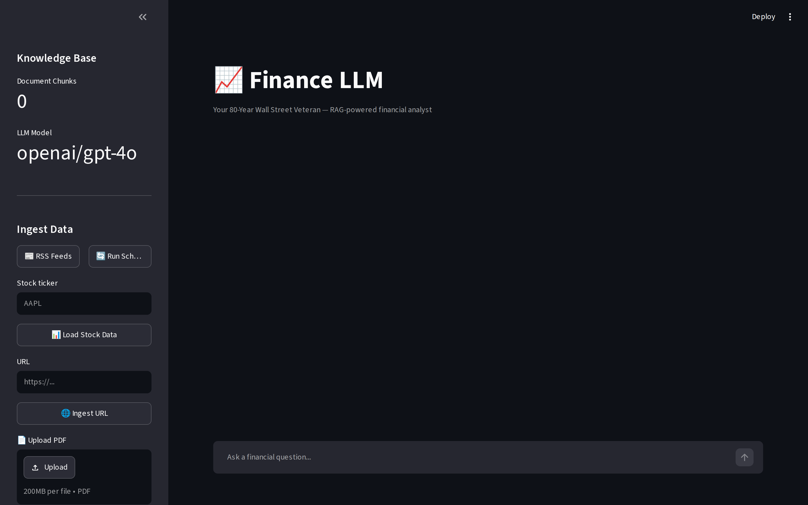
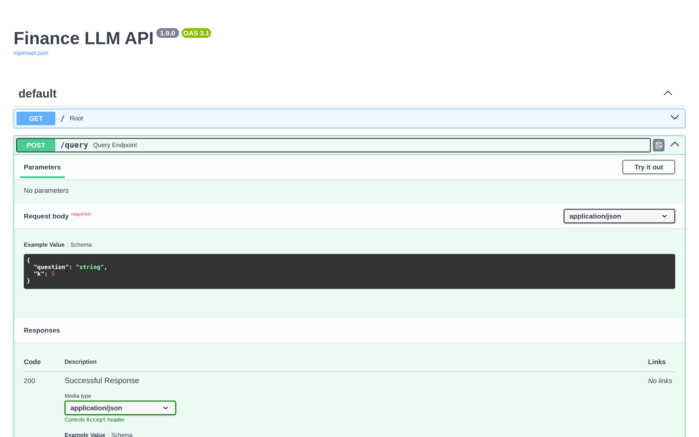
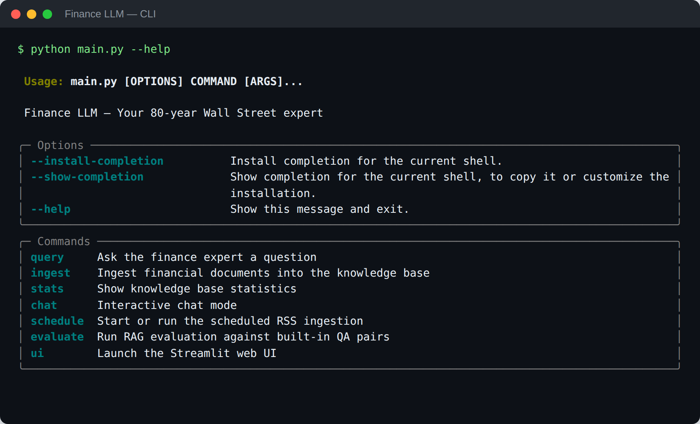
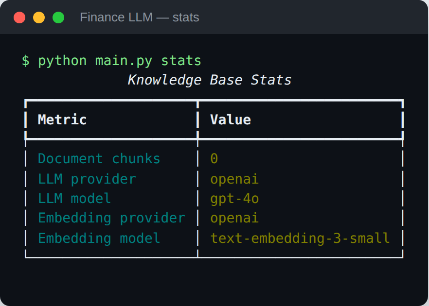
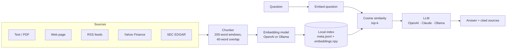

<div align="center">

# Finance LLM

**A retrieval-augmented financial analyst you can run from the terminal, a web UI, or a REST API.**

Ingest news, filings, PDFs and market data into a local vector index, then ask questions and get answers grounded in — and cited back to — the material you loaded.

[](https://python.org)
[](https://fastapi.tiangolo.com)
[](https://streamlit.io)
[](https://docker.com)
[](https://github.com/mutima89/finance-llm/commits)

[Overview](#overview) · [Screenshots](#screenshots) · [Quick start](#quick-start) · [Usage](#usage) · [Architecture](#architecture) · [Configuration](#configuration) · [Evaluation](#evaluation) · [Limitations](#known-limitations)

</div>

---

## Overview

Finance LLM is a compact Retrieval-Augmented Generation (RAG) pipeline for financial research. Documents are chunked, embedded and stored in a local NumPy index; at query time the most similar chunks are retrieved by cosine similarity and passed to an LLM together with an analyst system prompt. Every answer is returned with the source chunks it was built from and their similarity scores.

| Area | What it does |
|---|---|
| **LLM providers** | OpenAI, Anthropic Claude, or a local Ollama model — selected with one environment variable |
| **Embeddings** | OpenAI (`text-embedding-3-small` by default) or Ollama (e.g. `nomic-embed-text`), independent of the chat provider |
| **Ingestion** | Plain text, PDF (`pypdf`), any web page (BeautifulSoup), RSS news feeds, Yahoo Finance ticker data (`yfinance`), SEC EDGAR filings |
| **Retrieval** | Word-window chunking with overlap, cosine-similarity top-*k* search, index persisted to disk |
| **Interfaces** | Typer CLI (7 commands), Streamlit chat UI, FastAPI REST service with OpenAPI docs |
| **Automation** | Background scheduler re-ingests RSS feeds every *N* hours |
| **Evaluation** | Built-in five-question QA suite with synonym-aware topic matching |
| **Deployment** | Dockerfile and `docker-compose.yml` running the API and UI as separate services |

## Screenshots

| Web UI | REST API (OpenAPI docs) |
|:---:|:---:|
|  |  |
| **CLI** | **Knowledge-base stats** |
|  |  |

## Quick start

### Prerequisites

- Python 3.10 or newer
- One of: an [OpenAI API key](https://platform.openai.com/api-keys), an [Anthropic API key](https://console.anthropic.com/), or a running [Ollama](https://ollama.com) server
- Embeddings need either an OpenAI key or Ollama, even when the chat model is Claude

### Install

```bash
git clone https://github.com/mutima89/finance-llm.git
cd finance-llm

python -m venv .venv && source .venv/bin/activate
pip install -r requirements.txt

cp .env.example .env        # then edit .env and add your key(s)
```

> [!IMPORTANT]
> Settings are read from environment variables. The application does not currently call `load_dotenv()`, so when running outside Docker, export the file into your shell first:
>
> ```bash
> set -a && source .env && set +a
> ```
>
> Docker Compose reads `.env` automatically through `env_file`.

### First run

```bash
python main.py ingest --rss                 # pull the latest headlines
python main.py ingest --ticker AAPL         # add company data
python main.py stats                        # confirm what is indexed
python main.py query "What are the main risks in Apple's current outlook?"
```

## Usage

### Command line

| Command | Purpose | Key options |
|---|---|---|
| `query "<question>"` | One-shot question; prints the answer and a sources table | `--k` (chunks to retrieve, default 5) |
| `chat` | Interactive session; type `exit` to quit | — |
| `ingest` | Add documents to the index | `--file`, `--pdf`, `--url`, `--rss`, `--ticker`, `--sec` with `--sec-type` (`10-K`, `10-Q`, `8-K`) |
| `stats` | Chunk count and active provider/model settings | — |
| `schedule` | Re-ingest RSS feeds on an interval | `--interval` (hours), `--once` |
| `evaluate` | Run the built-in QA suite | — |
| `ui` | Launch the Streamlit interface | — |

Options can be combined in a single ingest call:

```bash
python main.py ingest --pdf reports/q3-earnings.pdf --url https://example.com/analysis
```

### Web UI

```bash
python main.py ui          # http://localhost:8501
```

The sidebar shows index size and the active model, and offers one-click ingestion of RSS feeds, ticker data, URLs and uploaded PDFs. Answers appear in a chat pane with an expandable **Sources** panel listing each retrieved chunk and its relevance score.

> [!NOTE]
> Opening the UI starts the background scheduler, which immediately runs one RSS ingestion and then repeats every `SCHEDULE_INTERVAL_HOURS`. Each ingestion makes embedding API calls.

### REST API

```bash
python -c "from finance_llm.app import serve; serve()"   # http://localhost:8000
```

Interactive documentation is generated at **`/docs`** (Swagger UI) and **`/redoc`**.

| Method | Path | Body | Returns |
|---|---|---|---|
| `GET` | `/` | — | Service status |
| `POST` | `/query` | `{"question": str, "k": int = 5}` | `{"answer": str, "sources": [{content, metadata, relevance_score}]}` |
| `POST` | `/ingest` | `{"text": str, "source": str = "manual", "metadata": dict?}` | `{"status": "ok", ...}` |
| `GET` | `/stats` | — | `{"document_chunks": int, "model": str}` |

```bash
curl -s -X POST http://localhost:8000/query \
  -H "Content-Type: application/json" \
  -d '{"question": "How do rising rates affect bond prices?", "k": 5}'
```

### Docker

```bash
docker compose up -d --build
# API → http://localhost:8000    UI → http://localhost:8501
```

Both services mount `./data` so the index persists across restarts and is shared between them. Note that each container holds its own in-memory copy of the index, loaded at start-up; restart the other service to see documents ingested through one of them.

## Architecture



**Request path.** The question is embedded with the same model as the documents, compared against every stored vector, and the top-*k* chunks are concatenated into the prompt. The system prompt instructs the model to treat retrieved context as its primary source and to distinguish it from general knowledge. If the index is empty, the question goes to the LLM without context and no sources are returned.

**Chunking.** `CHUNK_SIZE` and `CHUNK_OVERLAP` are expressed in characters but converted to words at roughly five characters per word, so the defaults (1000 / 200) produce 200-word chunks with a 40-word overlap.

**Storage.** The index lives in `data/chroma_db/faiss_index/` as a JSON-lines metadata file and a NumPy embeddings matrix. Despite the directory name, neither ChromaDB nor FAISS is used; search is a brute-force scan, which is adequate for thousands of chunks but not for millions.

### Project structure

```text
finance-llm/
├── main.py                  # CLI entry point
├── finance_llm/
│   ├── config.py            # Environment-driven settings, RSS feed list
│   ├── rag_engine.py        # LLM + embedding clients, index, retrieval
│   ├── ingestion.py         # Text, PDF, URL, RSS, yfinance, SEC loaders
│   ├── cli.py               # Typer commands
│   ├── app.py               # FastAPI service
│   ├── ui.py                # Streamlit interface
│   ├── scheduler.py         # Background RSS ingestion thread
│   └── evaluate.py          # QA evaluation suite and seed knowledge
├── data/                    # Created at runtime; index and documents
├── Dockerfile
├── docker-compose.yml
├── requirements.txt
└── .env.example
```

## Configuration

All settings are environment variables with defaults defined in [`finance_llm/config.py`](finance_llm/config.py).

**Models**

| Variable | Default | Notes |
|---|---|---|
| `FINANCE_LLM_PROVIDER` | `openai` | `openai`, `anthropic` or `ollama` |
| `FINANCE_LLM_MODEL` | `gpt-4o` | Model name for the chosen provider — **also used for Ollama** |
| `OPENAI_API_KEY` | — | Required for OpenAI chat or OpenAI embeddings |
| `ANTHROPIC_API_KEY` | — | Required when the provider is `anthropic` |
| `OLLAMA_BASE_URL` | `http://localhost:11434` | Ollama server address |
| `EMBEDDING_PROVIDER` | `openai` | `openai` or `ollama` |
| `EMBEDDING_MODEL` | `text-embedding-3-small` | Changing it requires rebuilding the index |

**Retrieval and scheduling**

| Variable | Default | Notes |
|---|---|---|
| `CHUNK_SIZE` | `1000` | Characters (≈ 200 words) |
| `CHUNK_OVERLAP` | `200` | Characters (≈ 40 words) |
| `TOP_K` | `5` | Default chunks per query |
| `SCHEDULE_INTERVAL_HOURS` | `6` | RSS re-ingestion interval |

**Provider examples**

```env
# Anthropic chat, OpenAI embeddings
FINANCE_LLM_PROVIDER=anthropic
FINANCE_LLM_MODEL=<claude-model-id>
ANTHROPIC_API_KEY=sk-ant-...
OPENAI_API_KEY=sk-...

# Fully local
FINANCE_LLM_PROVIDER=ollama
FINANCE_LLM_MODEL=llama3
EMBEDDING_PROVIDER=ollama
EMBEDDING_MODEL=nomic-embed-text
```

RSS sources (MarketWatch, Financial Times, The Economist, New York Times Business, Bloomberg Markets) are listed in `FINANCIAL_NEWS_RSS_FEEDS` in `config.py`; the five most recent items per feed are ingested on each run.

## Evaluation

```bash
python -m finance_llm.evaluate    # seeds an empty index, runs the suite, writes eval_report.json
python main.py evaluate           # runs the suite against the current index, prints only
```

The suite asks five questions (Fed policy, rates and bond prices, GAAP vs non-GAAP, P/E ratios, yield-curve inversion). A question passes when at least two of its expected topics appear in the answer, using synonym groups so that, for example, "price-to-earnings" matches "P/E".

This measures **topical coverage of the generated answer**, not retrieval precision or factual accuracy: a model can pass from general knowledge alone, and a correct answer phrased unusually can fail. Treat the score as a smoke test.

## Known limitations

- **`.env` is not loaded automatically** outside Docker (see [Install](#install)).
- **SEC ingestion** requests EDGAR's Atom feed but parses the response as JSON, so `--sec` currently returns no documents.
- **`OLLAMA_MODEL`** in `.env.example` is not read; Ollama uses `FINANCE_LLM_MODEL`.
- **`/ingest`** always reports `chunks_added: 1` regardless of how many chunks were created.
- **Ticker data** is the raw `yfinance` `info` dictionary serialised as JSON, which retrieves less cleanly than prose.
- **No deduplication**: re-ingesting the same feed or document adds duplicate chunks.
- **Embeddings are generated one chunk per API call**, which is slow for large PDFs.
- Answers are grounded in retrieved text but are not guaranteed to be correct. This project is a research tool, not investment advice.

## Contributing

Issues and pull requests are welcome — particularly fixes for the limitations above, additional data sources, and further evaluation cases. Please keep changes focused and describe how you tested them.

## License

No license file is included yet. Until one is added, all rights are reserved by the author.
